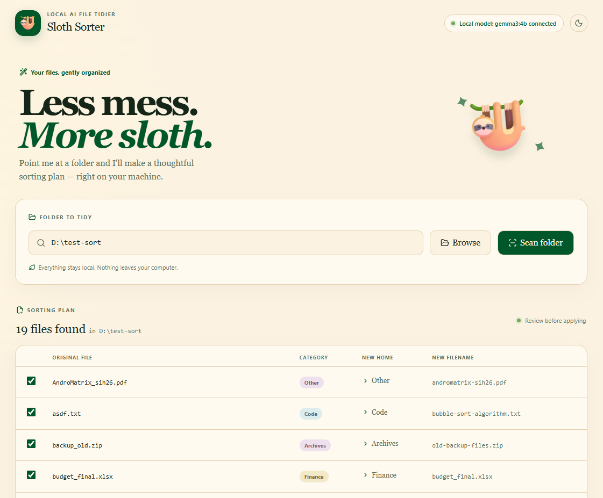
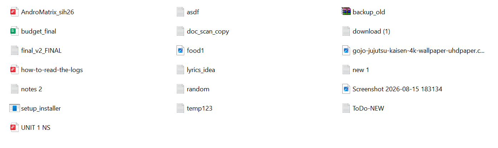
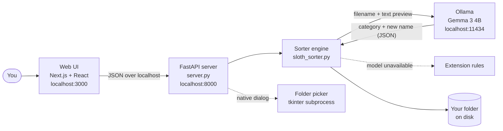
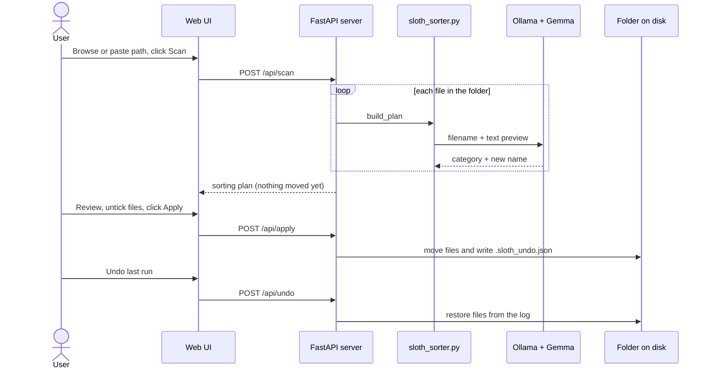
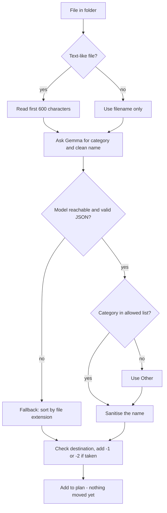

# 🦥 Sloth Sorter

**A lazy, local-AI file tidier.** Point it at a messy folder and an open-weight model running on your own computer decides where every file belongs and what to call it. You review the plan, click apply, and can undo it all. Nothing ever leaves your machine.

Built for the **DEV Hacktoberfest Open-Source AI Challenge, Week 3: "Slow and Steady"**.



---

## Table of contents

1. [The problem](#the-problem)
2. [What it does](#what-it-does)
3. [How it works](#how-it-works)
4. [Why open-weight AI](#why-open-weight-ai)
5. [Tech stack](#tech-stack)
6. [Project structure](#project-structure)
7. [API reference](#api-reference)
8. [Getting started](#getting-started)
9. [Usage](#usage)
10. [Safety design](#safety-design)
11. [Example results](#example-results)
12. [Configuration](#configuration)
13. [Troubleshooting](#troubleshooting)
14. [Limitations](#limitations)
15. [Roadmap](#roadmap)
16. [Credits and license](#credits-and-license)

---

## The problem

Everyone has a Downloads folder full of `IMG_2231 (1).jpg`, `final_v2_FINAL.pdf` and `new 1.txt`. Tidying it is a chore people put off for months, and cloud "AI organisers" mean uploading your bills, IDs and resumes to someone else's server.

## What it does

- **Scans a folder** and asks a local model to pick a category and a clean, descriptive filename for each file.
- **Shows a plan first.** Nothing moves until you review it and click **Apply**. You can untick any file.
- **Moves the files** into category folders (Documents, Images, Finance, Study, Code and so on).
- **Undoes the last run** with one click, restoring original names and locations.
- **Reads content, not just names.** For text-like files the model sees the first 600 characters, so `new 1.txt` containing an invoice becomes an invoice-named file in `Finance`.
- **Works without the AI.** If the model is unreachable, it falls back to sorting by file extension.
- **Has a web UI and a CLI.** Same engine behind both.

### Before and after

A deliberately messy 19-file test folder, before and after one scan and apply. One click on **Undo last run** restores the left side exactly.

<table>
  <tr>
    <th width="50%">Before</th>
    <th width="50%">After</th>
  </tr>
  <tr>
    <td valign="top"></td>
    <td valign="top"></td>
  </tr>
</table>

## How it works

### Architecture



Every arrow stays on your computer. The only network traffic is between processes on `localhost`.

### Request flow



### How each file is decided



Categories: `Documents`, `Images`, `Videos`, `Audio`, `Archives`, `Code`, `Installers`, `Finance`, `Study`, `Other`.

## Why open-weight AI

Sloth Sorter only works *because* the model is open:

- **Privacy.** Your bills, resumes and screenshots are exactly what you don't want to upload. Here, the model runs next to the files, so nothing leaves your computer.
- **No internet needed for the AI step.** After the one-time model download, the engine only talks to Ollama on `localhost`.
- **Free forever.** No API key, no per-file cost, no rate limits. Sorting 10,000 files costs the same as sorting 10: some electricity.
- **Swappable.** Any model Ollama can run works. Set `SLOTH_MODEL` to try a smaller or larger one.

## Tech stack

| Layer | Technology | Role |
|---|---|---|
| Model | **Gemma 3 4B** (open weights) | Classifies files and suggests names |
| Model runtime | **Ollama** | Runs the model locally, serves it on `localhost:11434` |
| Sorting engine | **Python 3** (standard library only) | Plan, move and undo logic, also usable as a CLI |
| API | **FastAPI** + Uvicorn | Exposes the engine to the web UI |
| Frontend | **Next.js 16**, React 19, Tailwind CSS 4, shadcn/ui | The interface (designed with v0) |
| Folder picker | **tkinter** (in a subprocess) | Native Windows "choose folder" dialog |

## Project structure

```
Sloth-sorter/
├── sloth_sorter.py        # Core engine + CLI
├── server.py              # FastAPI server around the engine
├── requirements.txt       # Python dependencies (fastapi, uvicorn)
├── start.bat              # One-click launcher (Windows)
├── README.md              # This file
├── LICENSE                # MIT
├── .gitignore
├── docs/                  # README screenshots
└── web/                   # Next.js frontend
    ├── app/
    │   ├── page.tsx       # The whole UI: scan, plan table, apply, undo
    │   ├── layout.tsx     # HTML shell and page metadata
    │   └── globals.css    # Theme (light and dark) and component styles
    ├── components/ui/
    │   └── button.tsx     # shadcn button used across the UI
    ├── lib/
    │   ├── api.ts         # The ONLY place the UI talks to the backend
    │   └── utils.ts       # Small className helper
    ├── public/            # Icons and images
    ├── package.json       # Frontend dependencies and scripts
    ├── package-lock.json  # Exact dependency versions
    ├── next.config.mjs    # Next.js configuration
    ├── postcss.config.mjs # Tailwind CSS pipeline
    ├── tsconfig.json      # TypeScript configuration
    └── components.json    # shadcn/ui configuration
```

### What each file is for

| File | Purpose |
|---|---|
| `sloth_sorter.py` | The brain. Scans a folder, builds a prompt, calls Ollama, validates the JSON answer, builds the move plan, applies it, writes the undo log. Runs standalone as a CLI. |
| `server.py` | A thin FastAPI wrapper. Exposes status, browse, scan, apply and undo as HTTP endpoints, validates input and restricts CORS to the local UI. |
| `start.bat` | Starts the API and the UI and opens the browser. |
| `requirements.txt` | Python packages for the API (the engine itself needs none). |
| `docs/` | Screenshots used in this README. |
| `web/app/page.tsx` | The single-page interface: folder box, Browse button, plan table with checkboxes, Apply and Undo buttons, summary card, error and loading states. |
| `web/app/layout.tsx` | Root layout and page title. |
| `web/app/globals.css` | Design tokens and styles for light and dark mode. |
| `web/components/ui/button.tsx` | Reusable button component with variants. |
| `web/lib/api.ts` | Typed `fetch` wrappers (`status`, `browse`, `scan`, `apply`, `undo`). Keeping all backend calls here made it easy to swap v0's mock data for the real API. |
| `web/lib/utils.ts` | Helper for merging CSS class names. |
| `web/package.json` | Frontend dependencies and the `dev`, `build` and `start` scripts. |
| `.sloth_undo.json` | Created *inside the folder you sorted* (not in this repo). Records every move so Undo can reverse it. |

## API reference

The server listens on `http://127.0.0.1:8000`. Interactive docs are at `/docs`.

| Method | Path | Purpose |
|---|---|---|
| `GET` | `/api/status` | Is Ollama reachable and is the model pulled? |
| `POST` | `/api/browse` | Opens the native folder dialog. Returns the chosen path, or `""` if cancelled. |
| `POST` | `/api/scan` | Body `{ "folder": "..." }`. Returns the plan: for each file its category and new name. Moves nothing. |
| `POST` | `/api/apply` | Body `{ "folder", "files": [...] }`. Moves the files marked `selected` and writes the undo log. |
| `POST` | `/api/undo` | Body `{ "folder" }`. Restores files from the undo log. |

## Getting started

**Prerequisites:** [Ollama](https://ollama.com), Python 3.10+ (the python.org installer includes tkinter), Node.js 20+.
Developed and tested on **Windows 11**.

```powershell
git clone https://github.com/ankitsingh0101/Sloth-sorter.git
cd Sloth-sorter

# 1. Download the model (about 3 GB, one time)
ollama pull gemma3:4b

# 2. Python environment
python -m venv .venv
.venv\Scripts\activate
pip install -r requirements.txt

# 3. Frontend dependencies
cd web
npm install
cd ..
```

If PowerShell blocks `activate`, run `Set-ExecutionPolicy -Scope Process Bypass` first.

### Run

**Option A: one click.** Make sure Ollama is running, then double-click `start.bat`.

**Option B: two terminals.**

```powershell
# Terminal 1: API (from the project root, venv active)
python -m uvicorn server:app --port 8000

# Terminal 2: UI
cd web
npm run dev
```

Open <http://localhost:3000>. The pill at the top should read **"Local model: gemma3:4b connected"**.

## Usage

### Web UI

1. Click **Browse** and choose a folder (or paste a path and click **Scan folder**).
2. Wait for the scan. The model is called once per file, so it takes a moment.
3. Review the plan. Untick any file you want left alone.
4. Click **Apply moves**.
5. Changed your mind? Click **Undo last run**.

> Try it on a copy of a test folder first, not your real Downloads.

### Command line

```powershell
python sloth_sorter.py C:\Users\you\Downloads            # dry run (safe preview)
python sloth_sorter.py C:\Users\you\Downloads --apply    # actually move files
python sloth_sorter.py C:\Users\you\Downloads --undo     # put everything back
python sloth_sorter.py C:\Users\you\Downloads --no-ai    # extension rules only
python sloth_sorter.py C:\Users\you\Downloads --model gemma3:1b
```

## Safety design

Letting software rename and move your files deserves caution, so:

- **Dry run by default.** The CLI previews unless you pass `--apply`. The UI shows a plan you must confirm.
- **One-click undo.** Every move is logged to `.sloth_undo.json` and can be reversed.
- **Never overwrites.** If the destination exists, the file becomes `name-1.ext`, `name-2.ext` and so on.
- **Top level only.** It doesn't recurse into subfolders, and it skips hidden files.
- **Refuses drive roots.** `C:\` or `D:\` themselves are rejected.
- **Validated input.** Categories must be on the allowed list, filenames are sanitised, and only the bare file name from the UI is used, which blocks path traversal like `..\..\file`.
- **Localhost only.** CORS allows only `localhost:3000`. The folder dialog is a `POST` endpoint, so other websites in your browser can't trigger it.
- **Graceful fallback.** If the model is unreachable or returns bad JSON, sorting continues by file extension.

## Example results

From a real run on a deliberately messy 19-file test folder. A small model's output varies a little from run to run, so your names may differ slightly.

| Original name | Sorted to | New name |
|---|---|---|
| `new 1.txt` | Finance | `invoice-4821.txt` |
| `download (1).txt` | Finance | `electricity-bill-october-2026.txt` |
| `random.txt` | Finance | `bank-statement-sept-2026.txt` |
| `final_v2_FINAL.txt` | Study | `dbms-revision-notes.txt` |
| `asdf.txt` | Code | `bubble-sort-algorithm.txt` |
| `temp123.txt` | Other | `grocery-list-temp.txt` |

The model is good but not perfect, and a few files land in a debatable category. That's why the plan is always shown for review before anything moves.

## Configuration

| Setting | Default | How to change |
|---|---|---|
| Model | `gemma3:4b` | `$env:SLOTH_MODEL="gemma3:1b"` before starting the API (use a smaller model on low-RAM machines) |
| API address used by the UI | `http://127.0.0.1:8000` | `NEXT_PUBLIC_API_URL` in `web/.env.local` |
| Categories | see above | `CATEGORIES` list in `sloth_sorter.py` |
| Text preview length | 600 characters | `preview()` in `sloth_sorter.py` |

## Troubleshooting

| Symptom | Fix |
|---|---|
| Pill says **"not connected"** | Start Ollama and run `ollama pull gemma3:4b`. |
| Red error: *Cannot reach the Sloth Sorter server* | The API isn't running on port 8000. Start it. |
| **Browse** shows *Not Found* | An old API process is still running. Stop it with `Ctrl+C` and start it again. |
| *Could not open the folder picker* | Python was installed without tkinter. Paste the path instead. |
| Folder dialog doesn't appear | It can open behind the browser. Check the taskbar. |
| Build error mentioning `lightningcss.win32-x64-msvc.node` | In `web/`, delete `node_modules` and `package-lock.json`, then run `npm install`. |
| "Hydration" warning in the dev overlay | Caused by browser extensions such as Grammarly. Harmless. |

## Limitations

- **Sequential scanning.** One model call per file, so large folders take time. Speed depends on your hardware.
- **PDFs and images are judged by filename only.** Only text-like files (`.txt`, `.md`, `.csv`, `.json`, `.py`, `.js`, `.html`, `.log`) have their content read.
- **One level of undo.** Applying again replaces the previous undo log.
- **Not recursive.** Only the top level of the chosen folder is organised.
- **Small-model mistakes.** A 4B model sometimes picks a questionable category. Review the plan.
- **If the model fails once, the rest of that scan uses extension rules.**
- **The "time saved" figure is a rough estimate**, not a measurement.
- **Windows-focused.** The backend logic also ran on Linux, but the full app has been tested on Windows 11.

## Roadmap

- Editable categories and filenames directly in the plan table
- Duplicate-file detection by content hash
- Reading PDFs and describing images with a local vision model
- Watch mode that tidies a folder automatically in the background
- Multi-level undo history

## Credits and license

- Model: **Gemma** by Google, run through **Ollama**
- UI scaffolded with **v0**; backend and integration built with help from **Claude**
- Built with **FastAPI**, **Next.js**, **Tailwind CSS** and **shadcn/ui**
- Made for the DEV Hacktoberfest Open-Source AI Challenge: *Slow and Steady*

Released under the **MIT License** (see `LICENSE`). Created by [@ankitsingh0101](https://github.com/ankitsingh0101).